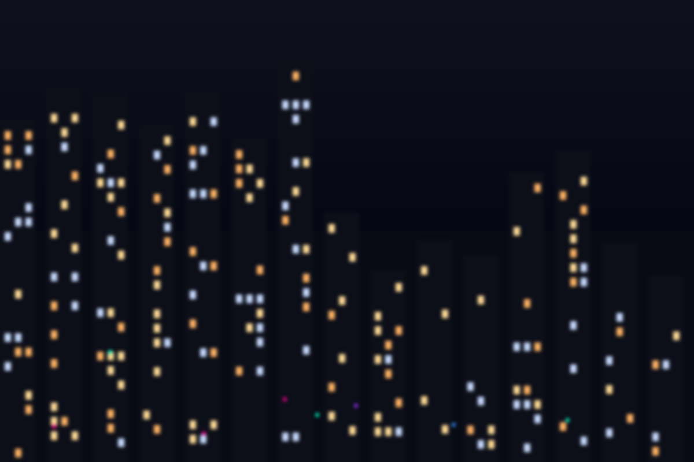

# Reloj Digital / Reloj_time

Reloj digital con temporizador de sesión, fondos nocturnos personalizables y modo claro/oscuro. Inspirado en [pomodorotimer.online](https://pomodorotimer.online/es).



## Características

### Reloj en tiempo real
- Formato 12 h / 24 h (botón de reloj), con preferencia guardada
- Fecha en español (día, mes y año)
- Actualización cada segundo; el intervalo se detiene mientras corre el temporizador

### Temporizador de sesión
- **Concentración** — 25 min por defecto
- **Descanso** — 5 min por defecto
- Controles: Iniciar / Pausar / Reiniciar; el botón principal cambia según el estado (Iniciar, Reanudar o Pausar)
- Minutos personalizables (1–120)
- Cuenta atrás basada en marca de tiempo: no se desfasa aunque la pestaña pierda el foco
- Pausa conserva el tiempo restante; Reanudar continúa donde se quedó
- Anillo de progreso que se vacía segundo a segundo
- Sonido al terminar: Ding / Chime / Campana / Ninguno
- Notificación del navegador (si se concede) y aviso visual al finalizar
- El título de la pestaña muestra el tiempo restante durante la sesión

### Fondos (10 opciones)
Disponibles desde el botón de imagen en la barra inferior:

**Degradados con glow**
1. **Urbano Nocturno** (predeterminado)
2. **Azul Profundo**
3. **Púrpura**
4. **Esmeralda**
5. **Ámbar**
6. **Rosa**

**Imágenes**
7. **Santuario Nocturno**
8. **Rincón Acogedor**
9. **Saturno**
10. **Cielo de Verano**

La elección se guarda en `localStorage` y se restaura al recargar. El selector usa miniaturas WebP (~20 KB en total) y los fondos completos están optimizados en WebP.

### Modo claro / oscuro
- Botón de tema en la barra inferior
- Preferencia persistente, aplicada antes del primer pintado para evitar destellos
- Velo de contraste sobre el fondo para mantener la lectura en ambos temas
- El color de la barra del navegador (`theme-color`) se actualiza con el tema

### Accesibilidad y craft
- Iconos SVG consistentes (sin emojis)
- Foco visible en todos los controles
- Selector de fondos con `role="dialog"`, `aria-modal`, trampa de foco, `inert` en el fondo y restauración del foco al cerrar
- `aria-pressed` / `aria-expanded` en los botones que lo necesitan
- Skip link, etiquetas accesibles y estados deshabilitados reales
- Movimiento con propósito: solo `transform` / `opacity`, transiciones por propiedad (nunca `transition: all`) y `prefers-reduced-motion` respetado
- Sin dependencias ni build step

## Uso

### Opción A: Servidor local (recomendado)
```bash
cd "Reloj digital"
python3 -m http.server 8080
# Abre http://localhost:8080
```

### Opción B: Abrir directo
```bash
xdg-open index.html
# O doble click en el archivo
```
> Al abrir como `file://` algunas funciones pueden fallar (notificaciones, sonidos, CORS). Usa la Opción A para la experiencia completa.

## Atajos de teclado

| Tecla | Acción |
|-------|--------|
| `Espacio` | Iniciar / Pausar (cuando el foco no está en un control) |
| `R` | Reiniciar temporizador |
| `T` | Alternar tema claro/oscuro |
| `F` | Alternar formato 12/24 h |
| `B` | Abrir selector de fondos |
| `Esc` | Cerrar el selector de fondos |

## Estructura del proyecto

```
Reloj digital/
├── index.html          # Estructura semántica + sprite SVG
├── style.css           # Tokens, layout y movimiento
├── script.js           # Reloj, temporizador, fondos, tema y atajos
├── assets/
│   ├── favicon.svg
│   ├── backgrounds/    # 10 fondos + thumbs/ (miniaturas WebP)
│   └── sounds/         # ding.wav, chime.wav, bell.wav
└── README.md
```

## Personalización

### Cambiar duraciones por defecto
En `script.js`:
```js
const MODE_DEFAULTS = {
  focus: 25, // minutos de concentración
  break: 5,  // minutos de descanso
};
```

### Agregar más fondos
1. Pon la imagen en `assets/backgrounds/`
2. En `script.js`, agrega una entrada al array `BACKGROUNDS`:
```js
{
  id: "bg-mi-fondo",
  name: "Mi Fondo",
  image: "assets/backgrounds/mi-fondo.webp",
  thumb: "assets/backgrounds/thumbs/mi-fondo.webp", // opcional, 160×160
  gradient: "none", // o un radial-gradient como capa extra
}
```
Si solo usas degradado, deja `image: ""` y define `gradient`.

### Cambiar colores (tokens CSS)
En `style.css`, sección `:root` (tema oscuro) y `:root.light` (tema claro):
```css
:root {
  --accent: #c4b5fd;        /* acento sobre fondo oscuro */
  --accent-fill: #7c3aed;   /* relleno de botones */
  --bg-color: #070911;      /* fondo base */
  --text: #f6f7fb;
  --muted: #b6bccd;
  /* ... */
}
```

## Tecnologías
- HTML5 semántico + CSS3 + JavaScript (ES6+)
- Sin dependencias, sin build step
- Fuentes del sistema (`ui-monospace`, `Segoe UI`, etc.)

## Licencia
MIT — Úsalo, modifícalo, compártelo.
