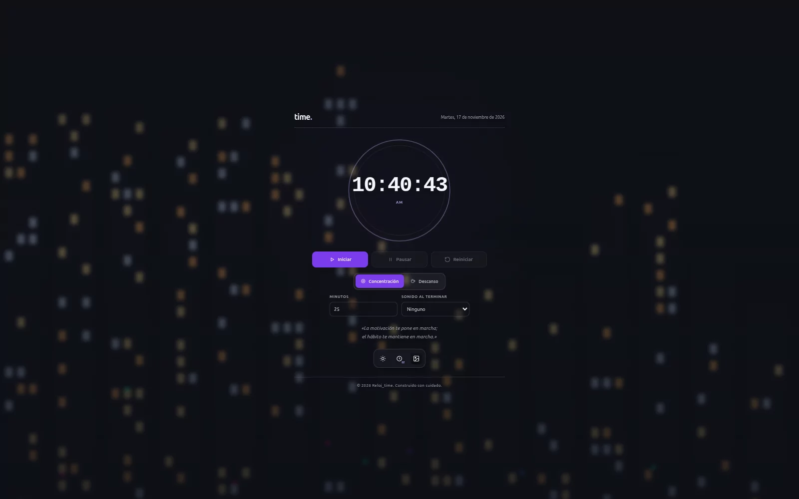

# Reloj Digital / Reloj_time

Reloj digital con temporizador de sesión, diez fondos personalizables y tema claro/oscuro. Inspirado en [pomodorotimer.online](https://pomodorotimer.online/es).



## Características

### Reloj en tiempo real
- Formato 12 h / 24 h con el botón de reloj o la tecla `F`; la preferencia se guarda.
- Fecha en español (día, mes y año).
- El reloj se actualiza cada segundo. Al iniciar una sesión, el centro pasa a la cuenta atrás; la fecha se actualiza durante la cuenta atrás y al volver a la pestaña. El reloj se reanuda al reiniciar o cuando la sesión termina.

### Temporizador de sesión
- **Concentración**: 25 min por defecto.
- **Descanso**: 5 min por defecto.
- Controles: **Iniciar**, **Pausar** y **Reiniciar**. El botón de inicio pasa a «Reanudar» en pausa y a «Nueva sesión» al terminar; **Pausar** toma el estilo principal mientras la sesión está en curso.
- Si no se inicia otra sesión, al terminar la interfaz vuelve sola al reloj a los 2,6 s.
- Minutos personalizables (1–120). El campo y los botones de modo se deshabilitan mientras la sesión corre o está en pausa; cambiar de modo restablece los minutos al valor por defecto de ese modo.
- Cuenta atrás basada en una marca de tiempo: no se desfasa aunque la pestaña pierda el foco.
- La pausa conserva el tiempo restante; Reanudar continúa donde se quedó.
- Anillo de progreso que se vacía segundo a segundo.
- Sonido al terminar: Ding / Chime / Campana / Ninguno.
- Notificación del navegador (si se concede) y aviso visual al finalizar.
- El título de la pestaña muestra el tiempo restante durante la sesión.

### Fondos (10 opciones)
Disponibles desde el botón de imagen de la barra inferior. El selector se abre como diálogo y guarda la elección en `localStorage`. Se cierra con `Esc`, con el botón de cerrar o haciendo clic fuera del panel.

**Ilustración con glow**

1. **Urbano Nocturno** (predeterminado): ilustración de una ciudad de noche.

**Degradados con glow**

2. **Azul Profundo**
3. **Púrpura**
4. **Esmeralda**
5. **Ámbar**
6. **Rosa**

**Imágenes**

7. **Santuario Nocturno**
8. **Rincón Acogedor**
9. **Saturno**
10. **Cielo de Verano**

El selector usa diez miniaturas WebP de 160×160 (~20 KB en total). Los cuatro fondos de imagen se sirven en WebP; los cinco degradados son PNG de unos 5 KB y la ilustración urbana es un PNG de unos 120 KB. Los originales 4K de esas imágenes viven en `assets/source/` (`bg-wallhaven-1.png` … `bg-wallhaven-4.png`) y no se cargan en la app.

### Modo claro / oscuro
- Botón de tema en la barra inferior o tecla `T`.
- Preferencia persistente, aplicada antes del primer pintado para evitar destellos.
- Velo de contraste sobre el fondo para mantener la lectura en ambos temas.
- El color de la barra del navegador (`theme-color`) se actualiza con el tema, incluido el ajuste previo al primer pintado.

### Accesibilidad y craft
- Iconos SVG consistentes (sin emojis).
- Foco visible en todos los controles.
- Selector de fondos con `role="dialog"`, `aria-modal`, trampa de foco, `inert` en el fondo y en el skip link, y restauración del foco al cerrar.
- `aria-pressed` / `aria-expanded` en los botones que lo necesitan.
- Skip link, etiquetas accesibles y estados deshabilitados reales.
- Movimiento con propósito: transiciones por propiedad (nunca `transition: all`) sobre `transform`, `opacity`, `background-color`, `border-color` y `color`; `prefers-reduced-motion` respetado.
- Sin dependencias ni build step.

## Uso

### Opción A: Servidor local (recomendado)
```bash
# Desde la raíz del proyecto
python3 -m http.server 8080
# Abre http://localhost:8080
```

### Opción B: Abrir directo
```bash
# Linux
xdg-open index.html

# macOS
open index.html

# Windows
start index.html
```

También puedes hacer doble clic en `index.html`.

> Al abrir como `file://` pueden fallar las notificaciones del navegador y la reproducción de audio por las restricciones de permisos y de reproducción del navegador; algunos navegadores también limitan `localStorage` en ese origen. Usa la Opción A para la experiencia completa.

## Atajos de teclado

| Tecla | Acción |
|-------|--------|
| `Espacio` | Iniciar / Pausar (cuando el foco no está en un control) |
| `R` | Reiniciar temporizador |
| `T` | Alternar tema claro/oscuro |
| `F` | Alternar formato 12/24 h |
| `B` | Abrir selector de fondos |
| `Esc` | Cerrar el selector de fondos |

> Los atajos se ignoran mientras escribes en un campo, con `Ctrl`/`Alt`/`Meta` o con repetición automática. Con el selector abierto, los atajos globales se desactivan y solo se gestionan `Esc` y `Tab`; `B` abre el selector y `Esc` lo cierra. Tras finalizar, `Espacio` inicia una nueva sesión si el foco no está en un control.

## Estructura del proyecto

```text
Reloj digital/
├── index.html          # Estructura semántica + sprite SVG
├── style.css           # Tokens, layout y movimiento
├── script.js           # Reloj, temporizador, fondos, tema y atajos
├── LICENSE             # MIT
├── assets/
│   ├── favicon.svg
│   ├── screenshot.webp
│   ├── backgrounds/    # 10 fondos + thumbs/ (10 miniaturas WebP)
│   ├── source/         # 4 originales PNG 4K (no se sirven)
│   └── sounds/         # ding.wav, chime.wav, bell.wav
└── README.md
```

## Personalización

### Cambiar duraciones por defecto
En `script.js`:

```js
const MODE_DEFAULTS = {
  focus: 25, // minutos de concentración
  break: 5,  // minutos de descanso
};
```

Al recargar, el campo de minutos toma el valor del modo activo. Si el campo queda vacío o recibe un valor inválido, se normaliza al valor por defecto; el rango se recorta a 1–120.

### Agregar más fondos
1. Optimiza la imagen completa a WebP y guárdala en `assets/backgrounds/` (o usa un PNG si es un degradado ligero).
2. Genera una miniatura cuadrada de 160×160 en `assets/backgrounds/thumbs/`. Con `ffmpeg`:

   ```bash
   ffmpeg -i assets/backgrounds/mi-fondo.webp \
     -vf "scale=160:160:force_original_aspect_ratio=increase,crop=160:160" \
     -c:v libwebp -quality 80 \
     assets/backgrounds/thumbs/mi-fondo.webp
   ```

3. Agrega una entrada al array `BACKGROUNDS` de `script.js`:

   ```js
   {
     id: "bg-mi-fondo",
     name: "Mi Fondo",
     image: "assets/backgrounds/mi-fondo.webp",
     thumb: "assets/backgrounds/thumbs/mi-fondo.webp", // opcional, 160×160
     gradient: "none", // o un radial-gradient como halo
   }
   ```

Si solo usas un degradado, deja `image: ""` y define `gradient`. Si añades un fondo al principio del array, la preferencia guardada (que usa el índice) puede apuntar a otra entrada; colócalo al final o actualiza la lógica de persistencia.

### Cambiar colores (tokens CSS)
En `style.css`, sección `:root` (tema oscuro) y `:root.light` (tema claro):

```css
:root {
  --accent: #c4b5fd;        /* acento sobre fondo oscuro */
  --accent-fill: #7c3aed;   /* relleno de botones */
  --bg-color: #070911;      /* fondo base */
  --text: #f6f7fb;
  --muted: #b6bccd;
  /* ... */
}
```

### Evitar caché antigua
Si editas `style.css` o `script.js`, sube el número de `?v=10` en `index.html` (hoja de estilos y script) para que el navegador descargue la versión nueva.

## Tecnologías
- HTML5 semántico + CSS3 + JavaScript (ES6+).
- Sin dependencias, sin build step.
- Fuentes del sistema (`ui-monospace`, `Segoe UI`, etc.).

## Licencia
MIT — consulta [`LICENSE`](LICENSE). La licencia cubre el código; las imágenes y los sonidos incluidos pueden tener sus propias condiciones de uso.
